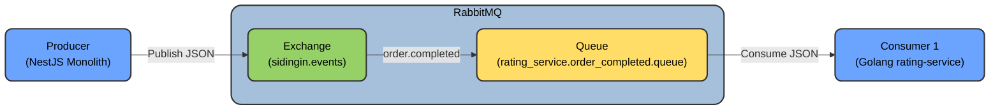

## Description

Rating Service is service that handle user to give rating.

Rating direction consist of:

- Customer -> Technician
- Customer -> Service Result
- Customer -> App
- Technician -> Customer
- Technician -> App

RabbitMQ Diagram:

- Exchange: sidingin.events
- Queue: rating_service.order_completed.queue
- Binding Routing Key: order.completed
